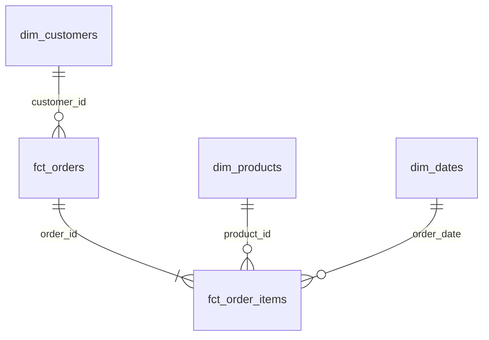
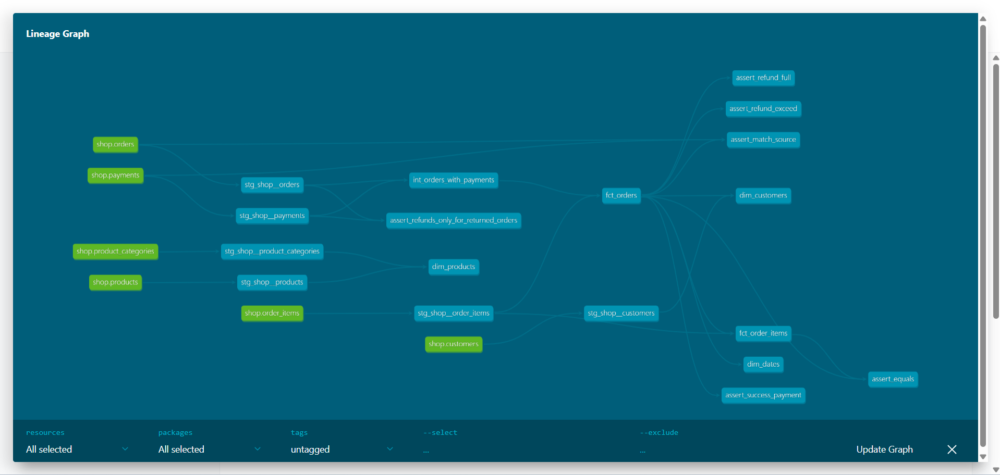

## Модель данных

## Витрины

витрина  |  зернистость  |  бизнес-вопрос
---------|---------------|-----------------
fct_orders | 1 строка - 1 заказ | выручка, подтверждённые заказы
fct_order_items	| 1 строка - 1 товар в заказе | какие товары покупают, выручка по категориям
dim_customers | 1 строка - 1 клиент	| кто покупает, откуда они
dim_products | 1 строка - 1 товар | иерархия категорий, бренды
dim_dates | 1 строка - 1 день | изменения выручки по периодам

## Хранение в Greenplum

витрина     |    распределение    |    обоснование
------------|---------------------|---------------
`fct_orders` | `distributed_by='order_id'` | потенциально большая таблица (заказы). таблицы `raw.orders`, `raw.payments` распределены по `order_id`.
`fct_order_items` | `distributed_by='order_id'` | большая таблица (товары в заказе). `raw.order_items` распределено по `order_id`.
`dim_customers` | `distributed_replicated=true` | таблица небольшая (40 строк). копирование в каждом сегменте позволяет быстрее производить join с фактами.
`dim_products` | `distributed_replicated=true` | таблица небольшая (13 строк). копирование на каждом сегменте более оптимально.
`dim_dates` | `distributed_replicated=true` | потенциально небольшая таблица. копирование на каждом сегменте более оптимально.

## Граф 

## Дополнительное задание

Использован пакет `dbt_utils` для генерации календаря (`date_spine`) в `dim_dates`. Пакет подключен через `packages.yml`.